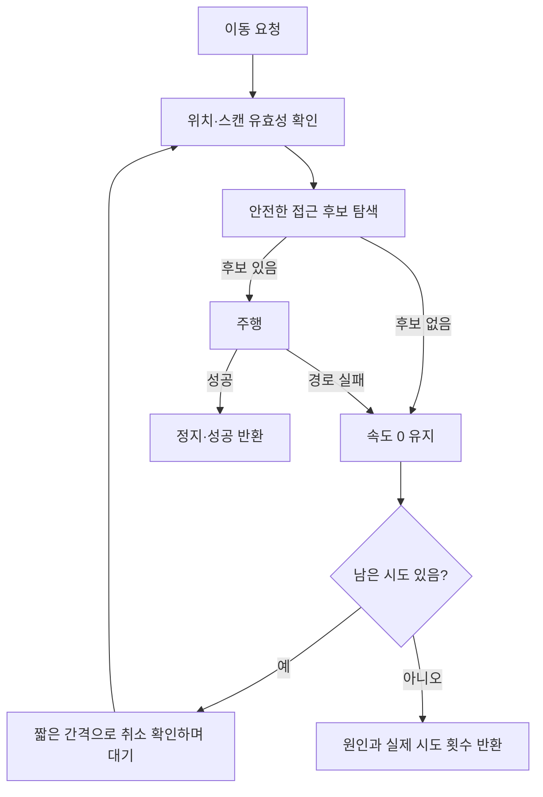

# C 주행 개선 결과 — 2026-11-17

## 1. 변경 요약

작업 브랜치: role_C. 최신 main 5c92abe 위에서 작업했다. commit·push는 하지 않았다.

| 변경 파일 | 구현 내용 |
|---|---|
| src/kickboard_robot/kickboard_robot/nav_bridge.py | 접근 후보 탐색 실패도 최대 시도 횟수에 포함. 취소 가능한 정지 대기. 위치·스캔·접근 지점 실패 구분. 경로 및 센서 복구 진단 로그 |
| src/kickboard_robot/kickboard_robot/sim_lidar.py | 노이즈가 유한 측정값을 range_max 밖으로 밀어내지 않도록 상·하한 제한. +inf 무응답 빔 유지 |
| docs/ROLE_C_NAVIGATION_PRD.md | 실제 구현 방식과 범위 갱신 |
| 이 문서 | 확인 결과와 남은 문제 기록 |

다른 담당 노드, 공유 common.py, robot_params.yaml, 인터페이스, 기존 테스트 파일은 수정하지 않았다.
planner.py는 조사만 수행했다. 안전 거리나 대각선 통과 금지를 완화하지 않았다.

## 2. 변경된 동작



- 기본 max_retries=2는 최초 1회 + 재시도 2회, 최대 3회다.
- 접근 후보가 계속 없으면 3회 후 안전하게 실패한다. 성공을 보장하는 변경은 아니다.
- 센서 미준비는 실제 시간으로 최대 5초 기다리고 실패 이유를 구분한다.
- 재시도 전에도 센서를 다시 확인한다. 취소·종료·센서 복구 실패 후 무작정 주행하지 않는다.
- 재시도 대기는 기존 0.1초를 유지하되 0.05초 이하로 취소·종료를 확인한다.
- 외부 GoToPose 정의는 변경하지 않았다. message와 attempts를 사용한다.
- 기존 make_goal의 목표 전용 반환은 유지하고 내부 resolve_goal이 (목표, 원인)을 반환한다.

## 3. 실행하면서 추가로 발견한 C 센서 결함

스캔 측정 프로브에서 12초 동안 56개 스캔을 받았다.
53개는 정상, 3개는 전방의 유한 측정값이 최대 거리 3.5m를 넘었다.
대표 값은 3.502925395965576m였다. sim_lidar가 노이즈의 최솟값만 제한하고 최댓값은 제한하지 않은 것이 원인이다.

nav_bridge는 이런 입력을 알 수 없는 측정으로 처리해 정지한다. 안전 검사를 느슨하게 바꾸지 않고
C 담당인 sim_lidar의 발행 범위를 맞췄다. 이 결함은 정렬 중 센서 타임아웃에 기여할 수 있지만,
해당 타임아웃의 모든 원인이 이것 하나라고 단정하지 않는다.

## 4. 검증

- 환경: WSL Ubuntu, ROS 2 Humble만 source한 셸, 별도 /tmp Humble 빌드.
- 기존 navigation·logic 테스트: 수정 전 33개 통과.
- 최종 코드: 기존 33개 + 임시 추가 검증 17개 = 50개 통과.
- 추가 검증: 접근 후보 복구, 지속 실패 3회, 취소·종료, 센서별 실패 이유, 센서 복구 상한,
  직접 목표 방향 유지, max_retries=0, 주행 실패 재시도, 센서 타임아웃 종료, goal lock 해제,
  라이다 노이즈 상·하한 및 +inf 유지.
- E 담당 저장소 테스트는 변경하지 않았다. 추가 검증 파일은 Windows 임시 폴더의
  test_role_c_navigation_review.py에 두었다. 영구 테스트 반영은 E와 협업할 항목이다.
- git diff --check 통과.

최종 재현 명령(임시 빌드가 남아 있는 현재 PC 기준):

```bash
cd /mnt/c/Users/chang/ROS_TermProject
bash --noprofile --norc
source /opt/ros/humble/setup.bash
source /tmp/ros_termproject_humble_install/setup.bash
ROS_DOMAIN_ID=73 python3 -m pytest -q src/kickboard_robot/test/test_navigation.py src/kickboard_robot/test/test_logic.py /mnt/c/Users/chang/AppData/Local/Temp/test_role_c_navigation_review.py
```

/tmp 빌드와 Windows 임시 검증 파일은 영구 배포 파일이 아니다. 다른 PC에서는 Humble 환경에서 다시 빌드해야 한다.

## 5. s5 no path 조사 결과

### 지도 비교

같은 도킹 출발점과 s5 목표를 비교했다.
- 정적 지도만 쓰면 1~7번의 접근 후보와 경로, 주차구역 A 경로가 존재했다.
- 모든 킥보드를 동시에 둔 합성 스냅샷에서는 4번의 안전한 접근 후보와 주차구역 A 경로가 없었다.
- 합성 스냅샷은 모든 킥보드가 동시에 존재한다고 가정한 진단이다. 시나리오 시간·수거·스캔 기억을 재생한 결과와 구분한다.

### 실제 kinematic 실행: 210초 관찰

2번·3번 적재가 진행됐다. 주차구역 A 목표 (-2.00, 1.35)로 이동할 때 다음 진단을 확인했다.

```text
No path: start=(-2.45, 0.25), goal=(-2.00, 1.35), goal clearance=0.30 m
이동 실패 1/3: no path
이동 실패 2/3: no path
이동 실패 3/3: no path
```

다른 출발점 (-1.18, 1.46)에서도 같은 목표 간격 0.30m가 기록됐다.
이는 통과 불가 기준인 반폭 0.47m보다 작다. 이 실행에서는 목표 자체가 코스트맵상 막혀 있었으므로,
대각선 검사만 원인이라고 단정할 수 없다. 실제 장애물과 남아 있는 스캔 기억의 기여도를 추가로 분리해야 한다.

목표는 D가 넘긴 standoff=0의 고정 하역 좌표다. C에서 임의로 목표를 이동하면 하역 위치·방향 계약을 깨뜨릴 수 있어
좌표를 바꾸거나 안전 거리를 줄이지 않았다. D·A와 동적 장애물 및 하역 자리 재선정 정책을 맞출 필요가 있다.

이 관찰은 센서 출력 범위 보완 전 실행이다. s5 전체 완주·성공률 검증 결과로 사용하지 않는다.

## 6. s1 통합 결과

최종 코드로 kinematic s1을 다시 실행해 약 115초에 아래 전체 흐름을 확인했다.

```text
NAVIGATING → VERIFYING → LOADING → 주차구역 B 하역
→ RETURNING → DOCKING → CHARGING → IDLE
```

- 킥보드 1 적재·주차구역 하역 완료.
- 정렬 중 센서 타임아웃과 이동 실패 로그 없음.
- 도킹 노드 보고값: 위치 오차 0.9cm, 방향 오차 2.2도.
- 이 수치는 kinematic 위치 추정 기준이다. Gazebo 실제 위치로 측정한 도킹 오차가 아니다.
- 단일 실행 결과이므로 반복 성공률이나 Gazebo 물리 충돌 검증으로 해석하지 않는다.
- 검증 중 생성한 모든 launch 프로세스는 종료했다. Gazebo GUI는 새로 띄우지 않았다.
- 초기 s1 관찰에서는 정렬 센서 타임아웃이 있었으며, 위 결과는 sim_lidar 보완 후 재실행 결과다.
- 자동 종료 중 SIGINT/KeyboardInterrupt 로그는 검증 종료 과정으로 구분했다. 실제 수거 완료 판정은 최종 상태 전이와 적재·하역 로그로 확인했다.

## 7. 후속 협업 항목

- A: C_nav_lidar.patch 원본과 장애물 입력 계약 제공. 이번 작업에는 원본 미확보로 해당 패치를 적용하지 않았다.
- D·A: s5 주차구역 A 목표가 동적 코스트맵상 막힐 때 하역 자리 재선정·재시도 기준 논의.
- E: 추가 17개 검증의 영구 테스트 반영, s1·s3·s9 회귀 확인.
- 팀: 시뮬 일시정지 중 센서 복구 제한을 실제 시간으로 유지할지 결정.
- kinematic 도킹 보고값은 5cm·5도 이내였다. Gazebo 실제 위치 기준 도킹 오차·물리 충돌·Nav2 모드는 이번에 검증하지 않았다.
