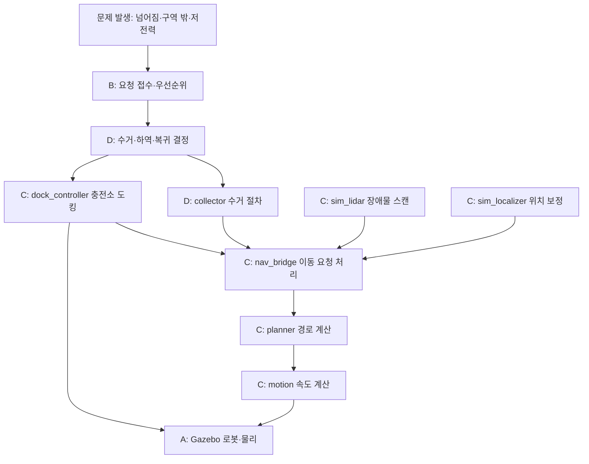
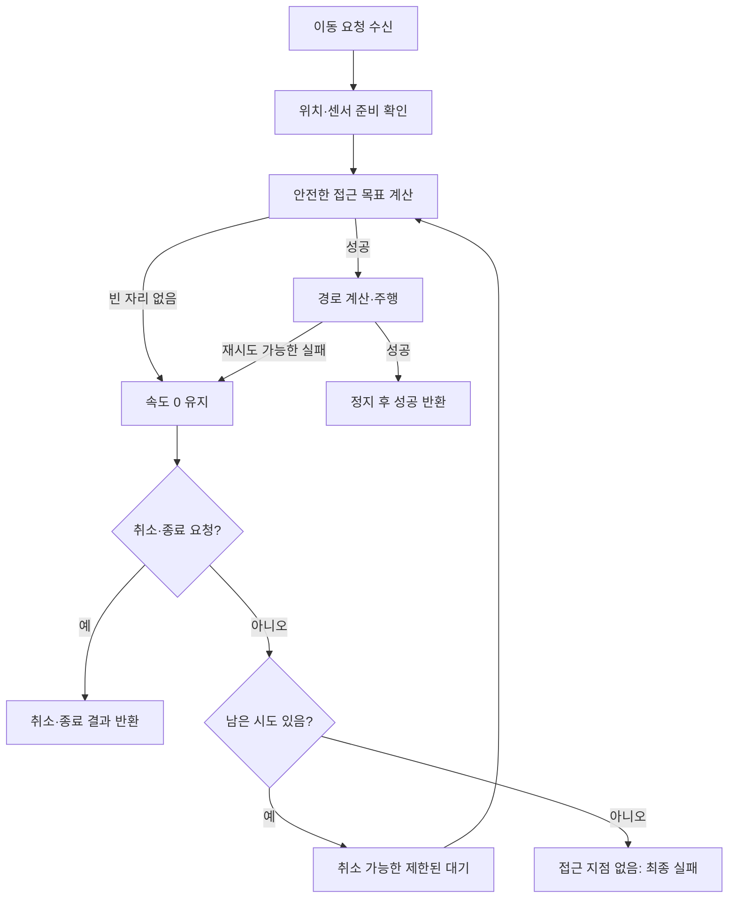

# C 주행·도킹 개선 PRD

- 작성일: 2026-11-17
- 상태: 1차 구현 및 kinematic s1 검증 완료. s5 문제 조사 결과와 남은 협업 항목은 변경 보고서에 기록한다.
- 기준: 현재 role_C = main 5c92abe, README 9·12장, 11월 17일 회의록
- 담당: C (monn098)
- 목표: 기존 안전 처리를 유지하면서 접근 실패를 재시도하고, 경로 실패 원인을 설명할 수 있게 한다.

## 1. 전체 프로젝트에서 C의 위치

공유 킥보드를 수거해 주차구역 또는 충전소에 내려놓는 로봇이다.
D가 목적지와 작업 순서를 정하면, C는 안전하게 이동하고 충전소에 도킹한다.

## 2. 이번 작업 범위와 담당 경계

### 2.1 1차 구현 대상으로 확정할 파일

| 파일 | 이번 변경 |
|---|---|
| src/kickboard_robot/kickboard_robot/nav_bridge.py | 접근 지점 탐색 실패 재시도, 실패 이유 구분, 정지·취소 유지, 진단 로그 |
| src/kickboard_robot/kickboard_robot/planner.py | 우선 원인 조사. 재현으로 결함이 입증되면 C 범위에서 수정 |

1차 구현은 nav_bridge부터 시작한다. planner 안전 기준을 낮춰 통과시키는 변경은 하지 않는다.

### 2.2 C 담당이지만 이번 1차에 바로 바꾸지 않는 파일

| 파일 | 사용 목적·후속 조건 |
|---|---|
| motion.py | 속도·회전 계산. 회전 접촉 문제가 재현될 때 검토 |
| sim_lidar.py | 통합 검증에서 확인한 노이즈 출력 범위 결함은 이번에 수정. A의 장애물 입력 확장은 패치를 확보한 뒤 별도 반영 |
| sim_localizer.py | 위치 보정. TF 오차가 확인될 때 검토 |
| dock_controller.py | 도킹. 도킹 오차를 측정한 뒤 원인에 따라 수정 |
| src/kickboard_sim/config/nav2_params.yaml | 팀이 Nav2 채택을 결정한 경우에만 작업 |

위 Python 파일은 모두 src/kickboard_robot/kickboard_robot/ 아래에 있다.

### 2.3 직접 수정하지 않는 담당 영역

| 담당 | 파일·영역 | 필요한 협업 |
|---|---|---|
| A | world·모델·launch·브리지·시나리오, scooter_fleet_sim 등 | C_nav_lidar.patch와 장애물 토픽 형식·좌표계·시각 전달 요청 |
| B | request_gateway·queue_manager·queue_logic·geo | s5 실험 시나리오 원본과 실패 로그 요청 |
| D | mission_manager·collector·battery_manager·drop_zones | 기존 이동 결과를 그대로 받아 동작하는지 확인 |
| E | kickboard_interfaces·test/·analyze·PRD | 회귀 테스트 추가·변경은 E와 조율 |
| 공유 | common.py·robot_params.yaml | 영향받는 담당자와 변경 범위를 정한 뒤 별도 작업 |

GoToPose 액션 정의, 토픽 이름, D의 상태 전이·수거 판단은 변경하지 않는다.
common.py는 C 패치 목록에 등장하지만 공유 코드이므로 자동으로 수정 대상에 넣지 않는다.

## 3. 문제 정의: 확인된 사실과 검증할 가설

| ID | 현상 | 근거·판정 |
|---|---|---|
| C-01 | 접근 지점이 없으면 max_retries를 쓰지 않고 바로 abort | nav_bridge._execute_goal의 goal is None 분기에서 확인 |
| C-02 | 현재 위치 없음과 접근 지점 없음이 같은 오류 메시지 | make_goal이 두 경우 모두 None을 반환하는 코드로 확인 |
| C-03 | s5에서 주차구역 A와 일부 킥보드에 no path | 회의록·B 실험 기록. 동적 장애물 기억과 대각선 검사 영향은 가설 |
| C-04 | 도로·장애물 패치에 필요한 API가 미반영 | Costmap.set_physical, free_spot의 keep_clearance가 현재 코드에 없음 |
| C-05 | 주행의 시뮬 시간과 실제 시간 사용 기준이 혼재 | 목표 제한·경로 갱신은 시뮬 시간, 센서 수신 감시·폴링은 실제 시간 사용 |

안전하지 않은 직선 목표로 대신 이동하는 예전 동작은 복원하지 않는다.

## 4. 1차 변경 설계: 접근 탐색과 이동 시도를 끝까지 관리

### 4.1 변경 전·후

변경 전에는 SEARCH 실패 직후 abort한다.
변경 후에는 안전하게 정지한 채 새 센서·지도 상태로 다시 탐색한다.
고정된 장애물 때문에 빈 자리가 계속 없으면 제한 횟수 후 실패한다. 재시도로 성공을 보장하지 않는다.

### 4.2 함수별 변경

| 함수 | 변경 계획 |
|---|---|
| resolve_goal / make_goal | resolve_goal이 목표와 실패 이유를 함께 반환. make_goal은 기존 목표 전용 반환 형식을 유지. standoff=0의 직접 목표 동작 유지 |
| _execute_goal | 최초 1회 + max_retries 재시도. 탐색 실패도 시도 횟수에 포함. 모든 실패·취소에서 정지 |
| run_simple | 주행 중 목표 재선택도 새 반환 형식 적용. 센서 소실·종료를 재시도 가능한 경로 실패와 구분 |
| 보조 대기 함수 | 짧은 간격으로 취소·종료 확인. 실패한 마지막 시도 뒤에는 불필요한 대기 없음 |

resolve_goal은 노드 내부 함수다. 외부 액션 필드 변경 없이 기존 Result.message와 attempts로 결과를 전달한다.
_execute_goal과 run_simple의 내부 호출부는 resolve_goal을 사용한다. 기존 make_goal API도 유지한다.

### 4.3 실패 결과와 재시도 정책

| 실패 이유 | 처리 |
|---|---|
| no safe approach point | 속도 0 → 대기 → 남은 횟수만큼 재탐색 |
| pose unavailable / sensor timeout | 속도 0 → 기존 센서 복구 대기 상한 적용 → 복구 실패 시 종료 |
| no path / blocked / 이동 시간 초과 | 기존 제한 횟수 정책 유지. 원인을 기록하고 재시도 |
| canceled / shutdown | 다음 시도 없이 즉시 정지·종료 |

기본 max_retries=2라면 최초 시도를 포함해 최대 3번이다.
재탐색 대기는 기존 0.1초 간격을 기본으로 검토한다. 60초 장애물 기억이 그 시간 안에 사라질 것으로 가정하지 않는다.
센서 복구 대기는 sensor_wait_timeout_sec를 따르며 무한 대기를 만들지 않는다.

### 4.4 유지할 안전 조건

- 센서·위치가 유효하지 않으면 전진·회전 명령을 내보내지 않는다.
- 대각선 모서리 통과 금지와 기존 장애물 간격을 유지한다.
- 빈 자리 탐색 실패를 검증되지 않은 직선 목표로 대체하지 않는다.
- 동시 goal 거절과 goal_lock 해제를 유지한다.
- 성공·실패·취소에서 속도 0을 발행한다.
- collector와 dock_controller의 명령 권한·호출 순서를 변경하지 않는다.

## 5. 2차 조사: s5 no path

1. 현재 s5와 B의 실험용 변형을 구분해 동일 입력으로 재현한다.
2. 실패 시 출발·목표 좌표, 현재 위치/스캔 유효성, 시도 횟수를 기록한다.
3. 같은 출발·목표에 대해 정적 지도만 쓴 결과와 동적 장애물을 합친 결과를 비교한다.
4. 접근 후보가 안전한 것과 그 후보까지 경로가 존재하는 것을 구분한다.
5. 필요하면 예전 main ef0b0ca와 별도 환경에서 비교한다. 현재 브랜치 코드를 되돌리지 않는다.
6. 재현 결과로 원인이 확인된 부분만 수정한다. 후보 도달 가능성 검사 등은 결과를 보고 설계한다.

완료 산출물: 실패 좌표별 재현 로그, 원인, 수정 필요 파일, 수정 전후 비교.
대각선 안전 검사 삭제 또는 장애물 기억 시간 축소를 먼저 해답으로 정하지 않는다.

## 6. 후속 작업: A 패치·시간 기준·도킹

### A 패치

C_nav_lidar.patch 원본을 먼저 확보한다. 이미 병합된 C 안전 처리 위에 항목별로 검토한다.
인도 진입 금지·스캔 시각·도킹 방향·장애물 입력을 한꺼번에 무검토 적용하지 않는다.
A 노드의 입력이 아직 없다면 C 구현과 전체 통합 확인을 구분해 기록한다.

### 시간 기준 제안 (팀 결정 전)

- 목표 제한 시간·재계획 주기·장애물 기억은 시뮬 시간 기준을 유지한다.
- 센서 무응답 감시와 취소를 확인하는 폴링은 실제 경과 시간 기준을 유지한다.
- 일시정지 시 센서 무응답으로 정지·실패할 수 있는 현재 정책을 명시하고 팀에서 결정한다.
- 취소가 막히는 긴 sleep_sim 대기로 일괄 교체하지 않는다.

### 도킹

Gazebo 기준 위치와 최종 로봇 위치·방향을 비교한다.
목표: 위치 오차 5cm 이하, 방향 오차 5도 이하.
기존 README 수치는 이전 환경 결과이므로 이번 실행의 실측값과 구분한다.

## 7. 검증·완료 기준

| 항목 | 통과 기준 |
|---|---|
| 탐색 복구 | 첫 탐색 실패 후 안전한 후보가 생기면 다음 시도에서 진행 |
| 지속 실패 | 최대 시도 횟수 후 실패, 최종 속도 0, 원인이 메시지에 표시 |
| 취소 | 재탐색 대기·이동·센서 대기 중 취소 시 다음 주행 없음 |
| 센서 소실 | 센서 복구 상한 후 정지·실패, 무한 재시도 없음 |
| 안전 회귀 | 기존 동시 goal·미측정 빔·대각선 모서리 관련 검증 유지 |
| s1 | 접근 → 확인 → 적재 → 하역 → 복귀·도킹까지 결과 기록 |
| s5 | 문서의 실패 지점 각각을 재현하고 원인·결과 기록. 성공하지 않아도 원인 미확정은 완료 아님 |
| E 협업 | test_navigation.py 기존 전체 실행. 새 테스트 파일 변경은 E와 조율 |

Humble 전용 빌드에서 검증한다. Iron 산출물을 혼합하지 않는다.
위 항목은 앞으로 수행할 기준이며, 이 문서에서 통과했다고 주장하는 결과가 아니다.

## 8. 진행 순서와 미팅 공유 자료

1. C-01·C-02: nav_bridge의 재시도·실패 구분 구현.
2. 기존 검증과 접근 실패·취소 조건 확인. 테스트 코드 변경이 필요하면 E와 조율.
3. s1 실행 후 s5 실패 지점 조사.
4. A 패치 확보·의존 관계 확인 후 C 파일에 분리 반영.
5. 도킹 오차·좁은 곳 회전 접촉 측정.

미팅에 공유할 것:
- 수정 파일과 동작 변화: 이전에는 즉시 실패 → 이후에는 정지하며 제한 횟수 재탐색.
- s1 실행 결과, s5 실패 좌표·원인·남은 문제.
- A 패치 반영 범위, E 검증 결과, 시간 기준 결정 요청.

## 9. Git 작업 흐름

role_C에서 최신 main 반영 → C 코드 수정·검증 → git diff 확인 → 사용자가 commit·push → PR로 main 병합.
충돌 또는 미커밋 변경이 있으면 기존 작업을 보존하며 처리한다.
1차 구현은 nav_bridge.py와 검증 중 범위 초과가 확인된 sim_lidar.py를 변경한다. 다른 담당 노드·공유 설정·기존 테스트 파일은 변경하지 않는다. 변경 보고서는 docs/ROLE_C_NAVIGATION_CHANGELOG.md에 기록한다.
